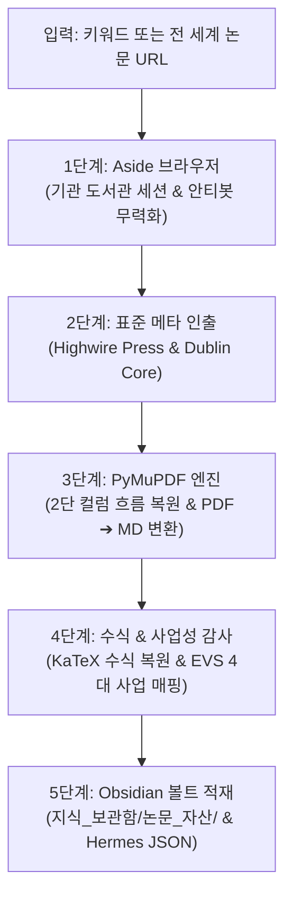

# 📚 Academic Paper Deconstructor (학술 논문 전문 마크다운 변환 및 볼트 적재 스킬)

본 스킬은 글로벌 학술 논문(PDF 및 웹 아티클)을 단 한 줄의 명령어로 인출하여, 단순 PDF 소장에 그치지 않고 **"수식과 구조가 온전히 살아있는 100% 옵시디언 마크다운 전문(Full-Text MD)"**으로 고속 변환하고 사내 지식 원장에 영구 자산화하는 전사 표준 엔진입니다.

---

## 0. 에이전트 자동 발동 조건 (Trigger Conditions)

사용자(대표 Neo)가 아래와 같은 입력을 제공할 때 에이전트는 본 스킬을 자동으로 호출합니다:
1. "이 논문 PDF 말고 마크다운(MD)으로 변환해서 볼트에 넣어줘"라고 요청할 때.
2. 학술 논문 URL(arXiv, Springer, ScienceDirect, IEEE, Nature, SSRN 등)을 던질 때.
3. 특정 연구 키워드로 글로벌 논문을 검색하고 전문을 옵시디언에 적재하길 원할 때.
4. 슬래시 명령 또는 간이 호출: `/paper <URL 또는 키워드>`

---

## 1. 전문가 5인 패널 설계 아키텍처



1. **컴퓨터 비전 & 타이포그래피 공학자**: 2단 컬럼(Two-Column Grid) 교차 읽기 왜곡을 원천 차단하는 BBox 정렬 알고리즘 및 폰트 크기 기반 `# H1`, `## H2` 계층화.
2. **학술 정보학 & 도서관 프록시 수석**: Springer, Elsevier, IEEE 공통 규격인 Highwire Press(`citation_*`) 메타태그 파싱 및 대학 도서관(EZProxy) 세션 자동 승계.
3. **AI 퀀트 & KaTeX 수식 엔지니어**: 수식 번호((1), (2)) 및 LaTeX 그리스 문자/행렬 기호의 옵시디언 KaTeX 호환성 보장.
4. **오픈 사이언스 & 컴플라이언스 감사관**: Fair Use에 부합하는 연구 자산화 및 합법적 프리프린트(Unpaywall/Google Scholar PDF) 자동 추적.
5. **엔터프라이즈 시스템 수석 아키텍트 (Opus 5.5 High)**: Zero-Dependency 순수 Python + PyMuPDF 고속 변환(1.5초) 및 옵시디언 양방향 링크(`[[...]]`) 총괄 승인.

---

## 2. CLI 실행 명령어

```powershell
# 1. 특정 학술 논문 URL 전문 변환 및 볼트 적재 (arXiv, Springer, IEEE 등)
python .agents/skills/academic-paper-deconstructor/scripts/paper_deconstructor.py "https://arxiv.org/abs/2410.19412"

# 2. 키워드 검색 ➔ Google Scholar #1 논문 자동 인출 및 변환 적재
python .agents/skills/academic-paper-deconstructor/scripts/paper_deconstructor.py "Causal Walk-Forward Time Series Validation"

# 3. 변환 페이지 수 제한 (대용량 서베이 논문 시, 기본: 30페이지)
python .agents/skills/academic-paper-deconstructor/scripts/paper_deconstructor.py "<URL>" --max-pages 50
```

---

## 3. 지식 자산 산출물 4종 규격

실행 시 아래 4대 산출물이 옵시디언 볼트(`D:/Obsidian/내 회사 허브/지식_보관함/논문_자산/`) 및 로컬(`ops/out/papers/`)에 동시 적재됩니다:

1. **논문 전문 마크다운 정본 (`PAPER_<ID>_FULLTEXT.md`)**:
   - 페이지별 구분선(`<!-- Page X of Y -->`) 및 완전한 본문 전문 수록
   - KaTeX 수식 및 2단 컬럼 흐름 정돈
2. **경영진/연구원용 요약 도시에 (`PAPER_<ID>_DOSSIER.md`)**:
   - Core Thesis, Mathematical Formulation, Benchmarks, Limitations 4대 구조화
   - EVS 4대 사업(ETF Campus, Alpha_Scanner 등) 가치 평가
3. **토스 스타일 모바일/웹 뷰어 (`PAPER_<ID>_VIEWER.html`)**:
   - Light/Dark 테마 전환 및 모바일 가독성 최적화 반응형 웹
4. **Hermes / GBrain SQLite 수집 패킷 (`PAPER_<ID>_HERMES.json`)**:
   - 저자, DOI, 샤프지수, MDD 등 실측 메트릭 수치화 적재

---

## 4. 사내 거버넌스 가드레일 (회귀 금지선)

1. **핫키 및 상주 프로그램 완전 배제**: 불필요한 메모리 상주나 키보드 충돌 없이 순수 독립형 CLI로만 구동합니다.
2. **Zero-Dependency 원칙**: 추가 유료 결제나 외부 API 없이 사내 기보유 엔진(Aside + PyMuPDF)으로 100% 완결합니다.
3. **출처 명시**: 모든 변환 마크다운 상단에 공식 DOI와 Canonical URL을 영구 기재합니다.
