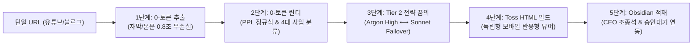

# 🌐 Omni-Intelligence Pipeline (전사 인텔리전스 사업 연계 스킬)

본 스킬은 외부에서 접하는 다양한 지식 매체(유튜브, 블로그, 뉴스 기사, 리포트, 강의)를 단 한 번의 인풋으로 흡수하여, **"우리 회사 4대 사업에 어떻게 접목할 것인가?"**를 고밀도로 평가하고 독립형 Toss HTML 리포트와 옵시디언 품의서로 완결하는 표준 파이프라인입니다.

---

## 0. 에이전트 자동 발동 조건 (Trigger Conditions)

사용자(대표 Neo)가 아래와 같은 입력을 제공할 때 에이전트는 본 스킬을 자동으로 호출합니다:
1. 유튜브 영상 링크(`https://youtube.com/watch?v=...`, `https://youtu.be/...`)를 입력하거나 분석을 요청할 때.
2. 네이버 블로그(`blog.naver.com`, `m.blog.naver.com`), 티스토리, 일반 웹 아티클 URL을 전달할 때.
3. "이 기사/영상 우리 사업에 어떻게 적용할 수 있는지 검토해줘"라고 요청할 때.
4. 슬래시 명령 또는 간이 호출: `/intel <URL>`

---

## 1. 실행 명령어 및 도구 인터페이스

에이전트는 사용자로부터 URL을 전달받으면 즉시 아래 통합 스크립트를 실행합니다:

```powershell
# 1. 기본 실행 (자동 대체 모드: Argon ➔ Sonnet Failover)
python D:/Brand_Command/04_Business_OS/ops/tools/run_intelligence_pipeline.py --url "<입력된 URL>"

# 2. 모델 직접 지정 (Claude Sonnet 5.5로 분석)
python D:/Brand_Command/04_Business_OS/ops/tools/run_intelligence_pipeline.py --url "<입력된 URL>" --model sonnet

# 3. 토큰 소모 0개 드라이런 (추출 및 1차 광고/사업 분류만 확인)
python D:/Brand_Command/04_Business_OS/ops/tools/run_intelligence_pipeline.py --url "<입력된 URL>" --dry-run

# 4. [안 C] 기각/폐기 체크된 품의서 및 HTML 리포트 일괄 영구 정리
python D:/Brand_Command/04_Business_OS/ops/tools/run_intelligence_pipeline.py --purge
```

---

## 2. 5단계 엔드투엔드 파이프라인



1. **[Step 1: 0-토큰 초고속 추출]**:
   - YouTube: `youtube-transcript-api`로 자막 및 타임스탬프 0.8초 추출 (토큰 0).
   - Naver Blog: `m.blog.naver.com` 모바일 엔드포인트 우회로 iframe 제거 후 `trafilatura`로 본문 무손실 추출 (토큰 0).
   - 일반 Web: `trafilatura` (실패 시 Jina Reader 클라우드 프록시 Fallback) (토큰 0).
2. **[Step 2: 0-토큰 노이즈 & 휴리스틱 린터]**:
   - PPL/광고("협찬", "원고료", "제휴 링크", "오픈채팅") 정규식 탐지 및 `ad_risk` 산출.
   - 4대 사업(ETF Campus, 연금 전자책, 여의도 웹소설, 마케팅) 키워드 빈도 매칭.
3. **[Step 3: Tier 2 전략적 사업 연계 품의]**:
   - `gemini-4-argon-high` (Google 7계정 풀) 1순위 호출.
   - 한도 도달 또는 API 오류 시 `claude-sonnet-5-5`로 자동 대체(Auto-Failover).
   - 산출물: 핵심 1줄 요약, 3대 포인트, 팩트 등급(Grade S/A/B/C/F), 3대 사업 연계 선택지:
     - `[안 A]` 사업 연계 실행 (제품/원고 직접 반영 또는 마케팅 스레드 중 AI 1순위 제안)
     - `[안 B]` 단순 지식 보관 (별도 태스크 생성 없이 GBrain 지식 원장 색인)
     - `[안 C]` 기각 및 완전 폐기 (가치 미달 또는 중복/테스트 시 HTML 및 마크다운 영구 삭제)
   - **권장안 표기 규칙**: 기호나 이모지(`✨` 등)를 일절 넣지 않고, 다른 안 대비 **진하게(전체 볼드 `**[안 X (권장안)] ...**`)** 시각적으로 차별화하여 표시.
4. **[Step 4: Toss 스타일 독립형 HTML 리포트]**:
   - `#F2F4F6` 배경 + `#FFFFFF` 라운드 카드 + `Pretendard Variable` 폰트.
   - 권장안 카드는 파란색 테두리(`border: 2px solid #3182F6`)와 진한 폰트 두께로 하이라이트.
   - 유튜브 타임스탬프 클릭 즉시 점프 앵커(`&t=123s`) 및 원클릭 링크 복사 플로팅 바.
   - 저장 위치: `D:/Obsidian/내 회사 허브/10_Daily_Briefing/intel_reports/YYYYMMDD_{slug}.html`
5. **[Step 5: Obsidian CEO 조종석 연계 및 영구 폐기]**:
   - 마크다운 품의서 저장: `D:/Obsidian/내 회사 허브/10_Daily_Briefing/intel_dossier/YYYY-MM-DD_{slug}.md`
   - 모닝 브리핑 및 `00_회사/승인대기.md`에 결재 대기 등록 (D2 A안 준수).
   - 대표가 `[안 C]` 기각 및 폐기를 체크할 경우 `--purge` 플래그로 파일 자동 영구 삭제.

---

## 3. 사내 거버넌스 가드레일 (회귀 금지선)

1. **D2 A안 준수**: 외부 인텔리전스를 바탕으로 한 2차 가공물(스레드 초안, 전자책 보충안, 웹소설 고증 등)은 대표(Neo)의 명시적 승인 전까지 절대로 대외에 자동 발행되지 않습니다.
2. **Zero Physical Header Injection**: 생성되는 옵시디언 개별 노트 상단에 불필요한 시스템 경고문(`[EPISTEMIC_MODE: ...]`)을 물리적으로 기입하지 않습니다.
3. **포지셔닝 원칙 엄수**: ETF Campus는 '순수 투자 교육 보조 툴'이며, Neo는 '1인 빌더·기록자'로 표기하고 금융투자업/자문업 오인 문구는 원천 배제합니다.
