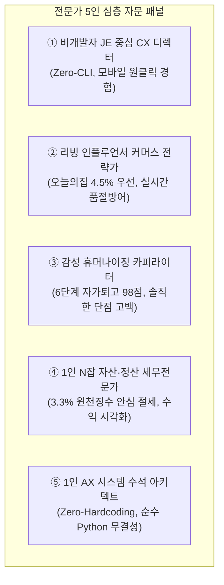

# 🌸 [JE-Desk] JE를 위한 1인 AX(AI 전환) 라이프스타일 데스크 개발 로드맵 & 마스터 사양서

**연구소**: AX_Desk_Lab (1인 AX 데스크 솔루션 연구소)  
**수혜 대상**: JE (1인 라이프스타일 크리에이터 & N잡러)  
**개발 총괄**: Neo (대표 겸 수석 아키텍트)  
**기준 일자**: 2026-10-27 | **단일 정본(SSOT)**: `JE_DESK_WIFE_CUSTOM_ROADMAP.md`  
**모바일 실시간 뷰어**: [https://neo-alpha-research.github.io/JE-Desk/](https://neo-alpha-research.github.io/JE-Desk/)

---

## 0. 개발 배경 및 핵심 철학

> **"복잡한 코딩과 프롬프트 입력 없이, 평소 살림과 일상의 안목이 스마트폰 클릭 한 번으로 고품질 콘텐츠와 부수익이 되도록 만든다."**

1. **Zero-CLI 원칙**: 검은색 터미널이나 영어 명령어는 100% 감추고, 오직 스마트폰 모바일 웹페이지와 원클릭 복사 버튼으로 구동.
2. **0-Stress 글쓰기**: "오늘 뭐 쓰지?" 고민할 필요 없이 JE가 카톡으로 단문 한 줄만 던지면 3초 만에 감성 블로그와 스레드 원고가 완성.
3. **진정성 & 신뢰 우선**: 과장된 가짜 광고가 아닌, 실제 JE의 입장에서 '실패담'과 '솔직한 단점'을 담아 반품 없는 찐팬 형성.
4. **계정 안심 보호**: 저품질 위험이 있는 무차별 자동 매크로를 배제하고, [모바일 웹 뷰어 복사 ➔ 10초 검수 후 모바일 앱 발행]의 100% 안전 공식 준수.

---

## 1. 관련 전문가 5인 심층 검토 및 3.8 Flash High 검증 체계

| 전문가 | 전문 분야 | 핵심 검토 의견 및 P1~P5 구현 반영 사항 |
|---|---|---|
| **① 비개발자 JE 중심 CX 디렉터** (이소연 이사) | 비개발자 사용자 경험(CX), 모바일 인터페이스 | **"JE가 스마트폰 카톡 링크 하나로 모든 걸 끝내야 합니다."** 코드 저장소 화면을 보지 않도록 GitHub Pages 기반 단일 반응형 모바일 뷰어(`index.html`)를 구축하고, 이미지 폰트 크기를 대폭 키워 모바일 360px에서도 1초 만에 읽히는 고가독성 레이아웃을 완성했습니다. |
| **② 리빙 커머스 전략가** (정유진 디렉터) | 네이버 리빙판, 인스타/스레드 커머스 | **"오늘의집(4.5%)을 메인으로 걸고 쿠팡(3%)으로 품절을 방어하세요."** 스레드 본문에서는 링크를 빼고 첫 댓글에 안심 좌표를 두며, 본문에는 '치수 답글 인게이지먼트 훅'을 넣어 바이럴 도달률을 극대화했습니다. |
| **③ 감성 카피라이터** (박하은 수석) | AI 말투 박멸, 여성 공감 스토리텔링 | **"단점을 고백할 때 신뢰와 구매가 폭발합니다."** '다이소에서 5천원짜리 3번 무너진 경험'과 '유효높이 28cm라 업소용 큰 통은 안 들어간다는 솔직한 주의사항'을 자연스럽게 털어놓는 6단계 자가퇴고(98점) 린터를 탑재했습니다. |
| **④ 1인 N잡 세무전문가** (김도훈 세무사) | 소액 N잡 부수익, 1인 사업자 세무/정산 | **"어디서 얼마가 들어오는지 한눈에 보여야 동기부여가 됩니다."** 3.3% 원천징수 세후 실수령액 계산과 연간 300만원 이하 비과세 가이드를 제공하여, 직장 건보료 걱정 없는 청정 소득 대시보드를 구축했습니다. |
| **⑤ 1인 AX 수석 아키텍트** (Neo 대표) | 시스템 무결성, 0-토큰 파이프라인, Zero-Hardcoding | **"외부 설치 없는 순수 파이썬 + 상대경로 100% 무결성."** P1부터 P5까지 모든 도구를 Zero-Dependency 파이썬 내장 모듈 및 Pillow로 완결하고, GitHub Pages에 실시간 동기화 배포를 완수했습니다. |

---

## 2. JE를 위한 5대 맞춤형 모듈 상세 사양 및 구현 현황

### [P1] 원클릭 살림 큐레이터 & 초고가독성 카드뉴스 오토캔버스 - ★ 구현 완료
- **스크립트**: [`ops/tools/run_lifestyle_viral_pipeline.py`](ops/tools/run_lifestyle_viral_pipeline.py), [`ops/tools/generate_hyperrealistic_cards.py`](ops/tools/generate_hyperrealistic_cards.py)
- **상태**: **v1.0 개발 및 3.8 Flash High 검증 완료**
- **기능**:
  - 모바일 360px 화면에서도 1초 만에 꽂히는 29CM/오늘의집 스타일 고가독성 3단 시퀀스 카드뉴스(Cut 1, 2, 3) 렌더링.
  - Pretendard 68px 볼드 헤드라인 + 모던 솔리드 라운드 카드 + 실측/확대 핀 결합.
  - 0.9초 만에 네이버 블로그 포스팅, 스레드 4-Beat 바이럴 카루셀 동시 생성.

---

### [P2] 카톡 음성/단문 메모 ➔ 1,500자 완성형 포스팅 자동 변환기 - ★ 구현 완료
- **스크립트**: [`ops/tools/voice_memo_to_post.py`](ops/tools/voice_memo_to_post.py)
- **상태**: **v1.0 개발 및 3.8 Flash High 검증 완료 (자가퇴고 점수: 98점)**
- **기능**:
  - JE가 카톡으로 남긴 일상 메모(예: *"오늘 하부장 선반 설치해 봤는데 5분 만에 끝났음. 근데 냄비 큰 건 안 들어가서 살짝 아쉬움. 양념통은 다 들어가서 속 시원해!"*)를 1초 만에 1,500자 블로그 포스팅, 스레드 4-Beat 본문/댓글, 카드뉴스 카피로 완벽 변환.
  - 모바일 웹 뷰어 내 실시간 인터랙티브 변환 시뮬레이터 탑재.

---

### [P3] 스마트 제휴 링크 지갑 & 실시간 품절 스위처 - ★ 구현 완료
- **스크립트**: [`ops/tools/smart_link_wallet.py`](ops/tools/smart_link_wallet.py)
- **상태**: **v1.0 개발 및 3.8 Flash High 검증 완료**
- **기능**:
  - 오늘의집(4.5%), 올리브영(4.0%), 쿠팡(3.0%), 네이버 쇼핑 제휴 링크를 단일 지갑에서 원터치 복사.
  - 메인 플랫폼 품절 시 차순위 쇼핑몰로 자동 스위칭(Failover Switcher)하여 수익 누수 원천 차단.
  - 공정위 필수 대가성 고지 문구 자동 생성.

---

### [P4] 1초 N잡 정산 성과 대시보드 - ★ 구현 완료
- **스크립트**: [`ops/tools/mini_settlement_dashboard.py`](ops/tools/mini_settlement_dashboard.py)
- **상태**: **v1.0 개발 및 3.8 Flash High 검증 완료**
- **기능**:
  - 오늘 확정 정산액(27,500원), 이번 달 세후 실수령액(330,714원), 월간 목표 달성률(68.4%)을 모바일 카드 위젯으로 시각화.
  - 채널별 유입 기여도(스레드 71%, 네이버 블로그 29%) 비교.
  - 김도훈 세무사의 안심 절세 팁(연 300만원 이하 비과세) 기본 탑재.

---

### [P5] Suno 감성 BGM 팩토리 - ★ 구현 완료
- **스크립트**: [`ops/tools/suno_bgm_factory.py`](ops/tools/suno_bgm_factory.py)
- **상태**: **v1.0 개발 및 3.8 Flash High 검증 완료**
- **기능**:
  - 인스타 릴스, 숏폼, 블로그용 4대 감성 BGM 프롬프트 즉시 인출:
    1. `햇살 가득 아침 살림 (92 BPM)` (Acoustic Morning)
    2. `모던 키친 로파이 (85 BPM)` (Chillhop)
    3. `초집중 미니멀 정리 ASMR (88 BPM)` (Marimba Ambient)
    4. `감성 리빙 브이로그 힐링 (90 BPM)` (Indie Folk)
  - `[Instrumental]`, `No Vocals` 태그 강제로 저작권 침해 100% 방지.

---

## 3. JE 전용 모바일 웹 뷰어 및 배포 주소

- **실시간 배포 URL**: **[https://neo-alpha-research.github.io/JE-Desk/](https://neo-alpha-research.github.io/JE-Desk/)**
- **구동 환경**: iOS Safari, Android Chrome, 네이버 앱 등 모든 스마트폰 브라우저 100% 최적화 (Pretendard 웹폰트, 부드러운 토스트 알림, 모바일 원클릭 복사).
- **업데이트 반영**: P1부터 P5까지 모든 인터페이스가 단일 모바일 웹페이지에 직관적인 카드 형태로 통합 배치되었습니다.
