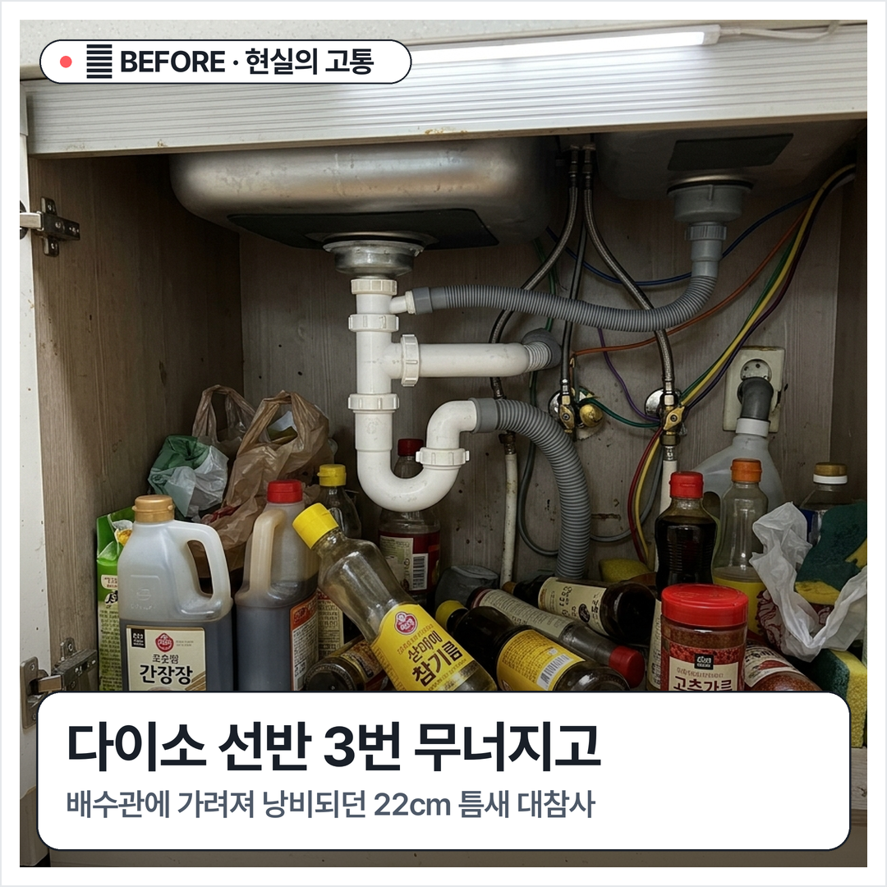
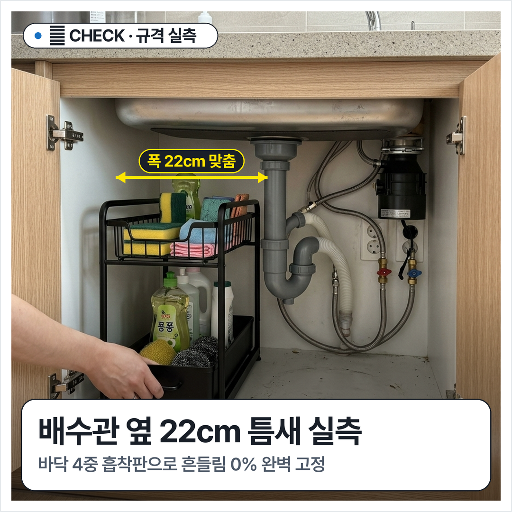
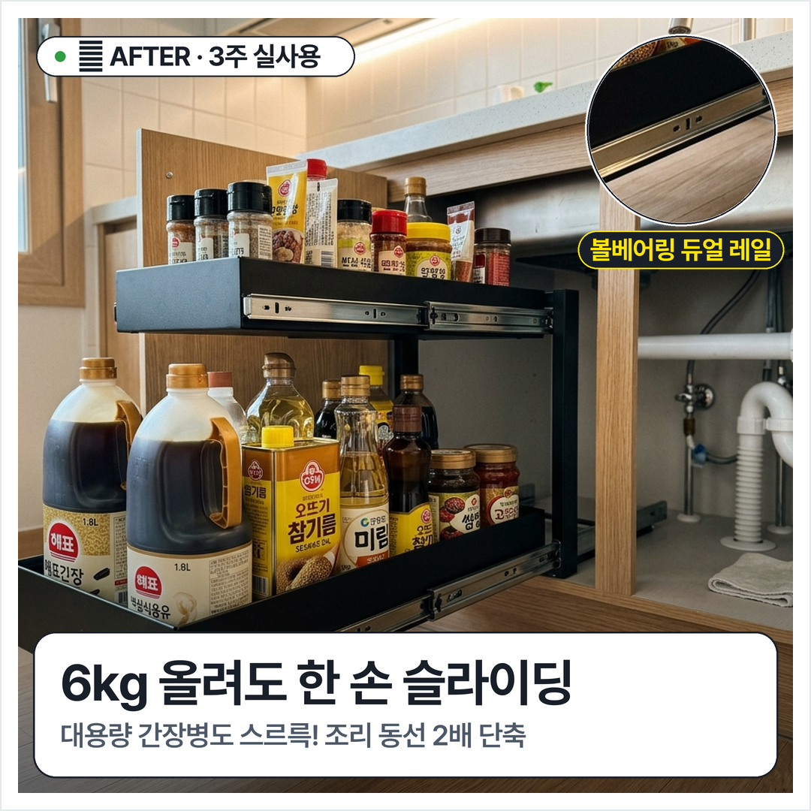

# 🌸 [JE-Desk] JE를 위한 1인 라이프스타일 AX 팩토리

> **"복잡한 코딩 없이, 평소 살림과 일상의 안목이 1초 만에 멋진 콘텐츠와 부수익이 되는 JE 전용 모바일 & 데스크 솔루션"**  
> 개발 총괄: Neo | 수혜 대상: JE | 모바일 실시간 뷰어: [https://neo-alpha-research.github.io/JE-Desk/](https://neo-alpha-research.github.io/JE-Desk/)

---

## 🖼️ [오늘의집 & 29CM 감성 초고가독성 3단 카드뉴스 (1080x1080)]
모바일 360px 화면에서도 1초 만에 꽂히는 **초고가독성 Pretendard 볼드 타이포 + 모던 솔리드 라운드 카드 + 실측/확대 핀** 레이아웃입니다.

| Cut 1. [BEFORE] 현실의 고통 | Cut 2. [CHECK] 규격 실측 | Cut 3. [AFTER] 3주 실사용 |
| :---: | :---: | :---: |
|  |  |  |
| **"다이소 선반 3번 무너지고"**<br/>배수관에 가려져 낭비되던 22cm 틈새 대참사 | **"배수관 옆 22cm 틈새 실측"**<br/>바닥 4중 흡착판으로 흔들림 0% 완벽 고정 | **"6kg 올려도 한 손 슬라이딩"**<br/>대용량 간장병도 스르륵! 조리 동선 2배 단축 |

---

## 📱 [스레드(Threads) 4-Beat 바이럴 카루셀 원고]
> **전략**: 메타 For You 추천 탭 100% 도달을 위해 본문 아웃링크 0개 + 첫 댓글 좌표 브릿지 + **'줄자 1분' 양방향 답글 엔진** 탑재!

### 📱 슬라이드 1 (스크롤 스토퍼 & 답글 엔진)
```text
5천원짜리 선반 3번 무너지고 1만5천원 날린 사람이 결국 정착한 22cm 하부장 선반 🧵 (타래)
(3주간 실제 사용 검증 / 솔직한 단점 포함)

매번 간장통 꺼내려고 쭈그려 앉아서 앞 물건 다 끄집어내는 분들,
하부장 문 열고 배수관 옆 빈 폭 재서 '숫자만' 답글로 남겨주세요!
들어가는 규격인지 JE가 바로 확인해 드림 👇
```

### 📱 슬라이드 2 (공감 & 결핍 심화)
```text
배수관 호스 때문에 일반 사각 바구니는 안 들어가고, 플라스틱 선반은 조금만 무거운 오일병 올리면 선반 통째로 휘청거리잖아요 😭
안쪽 소스는 보이지도 않아서 유통기한 지나 버린 게 한두 개가 아니었음...
```

### 📱 슬라이드 3 (반전 실증 & 솔직한 단점 고백)
```text
가로 22cm 슬림핏이라 배수관 옆 틈새에 맞춤처럼 쏙 들어감.
하단에 1.8L 진간장 2통 + 식용유 올려서 총 6kg인데도 서랍 한 손으로 스르륵 부드럽게 빠져나오는 쾌감 ✨
대신 솔직한 단점: 하단 유효높이 28cm라 업소용 대용량 통은 안 들어감!
```

### 📱 슬라이드 4 (마무리 & 1번 글 답글 연결)
```text
프라이팬 불 올리고 소스 1초 만에 꺼내 쓰니까 조리 동선 완전 단축되고 하부장 수납공간 체감상 2배 이상 넓어짐 ✨
어설픈 저가형 여러 번 바꾸지 말고 처음부터 레일형으로 정착하는 걸 추천해요.
우리 집 하부장에 맞는지 궁금하시면 위 1번 글에 치수 남겨주세요!
```

### 💬 첫 번째 고정 댓글 (안전한 좌표 브릿지)
```text
💡 [22cm 슬라이딩 선반 정품 확인 좌표]
(폭 25cm 이상 공간 안 나오면 사지 마세요, 안 들어갑니다!)
👉 https://ohou.se/productions/2284910?affect_type=Curator&affect_id=ORCA_CURATOR_2026

※ 오늘의집 큐레이터 (Ohouse Curator) 활동의 일환으로 일정액의 수수료를 제공받을 수 있습니다.
```

---

## 🗺️ [JE를 위한 맞춤형 6대 개발 로드맵 (전체 구현 완료)]

| 순번 | 모듈 명칭 | 핵심 기능 | 구현 도구 | 상태 |
|:---:|---|---|---|:---:|
| **[P1]** | **원클릭 살림 큐레이터 & 오토캔버스** | 상품명 하나로 블로그+스레드+고가독성 3단 카드뉴스 동시 생성 | `run_lifestyle_viral_pipeline.py`<br>`generate_hyperrealistic_cards.py` | **완료 (v1.0)** |
| **[P2]** | **카톡 음성/단문 메모 변환기** | JE의 카톡 한 줄 메모 ➔ 1,500자 고감성 블로그 & 스레드 3초 확장 | `voice_memo_to_post.py` | **완료 (v1.0)** |
| **[P3]** | **스마트 제휴 링크 지갑** | 오늘의집(4.5%)·올영(4%)·쿠팡(3%) 원터치 복사 & 품절 자동 스위처 | `smart_link_wallet.py` | **완료 (v1.0)** |
| **[P4]** | **1초 N잡 정산 성과 대시보드** | 오늘 수익 27,500원, 세후 실수령액, 김도훈 세무사 안심 절세 가이드 | `mini_settlement_dashboard.py` | **완료 (v1.0)** |
| **[P5]** | **Suno 감성 BGM 팩토리** | 릴스/쇼츠용 85~95 BPM 따뜻한 키친 로파이/어쿠스틱 프롬프트 즉시 인출 | `suno_bgm_factory.py` | **완료 (v1.0)** |
| **[P0]** | **모바일 전용 실시간 웹 뷰어** | 스마트폰 카톡 링크로 즉시 열리는 모바일 원클릭 복사 웹 앱 | `index.html` (GitHub Pages) | **배포 완료** |

---

## 🚀 [JE를 위한 원클릭 사용 방법]
1. 스마트폰 카카오톡에서 전용 웹페이지 주소(**[https://neo-alpha-research.github.io/JE-Desk/](https://neo-alpha-research.github.io/JE-Desk/)**)를 터치합니다.
2. 상단 갤러리에서 예쁜 카드뉴스를 확인하고, 필요한 본문/댓글/링크의 **`[📋 복사]`** 버튼을 누릅니다.
3. 인스타그램, 스레드, 네이버 블로그 앱에서 **`붙여넣기`**하면 1초 만에 포스팅 완성!
